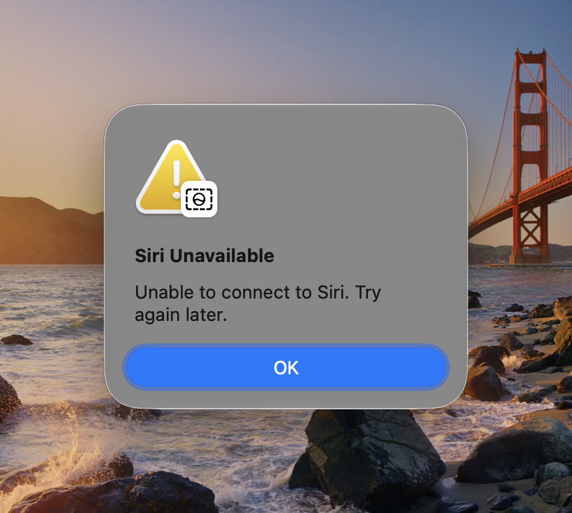

<p align="center">
  <picture>
    <source media="(prefers-color-scheme: dark)" srcset="docs/logo-dark.svg">
    
  </picture>
</p>

# Sirial Killer

Get Cmd+Shift+Space back from Siri on macOS. Siri itself keeps working; only its grip on this one shortcut goes.

> **Note:** All of this, the scripts and this README, was generated with [Claude Code](https://claude.com/claude-code), Anthropic's AI coding tool, and tested by hand on macOS 27.

macOS 27 added a Siri shortcut, **Ask Siri about active window**, and bound it to Cmd+Shift+Space. You can turn it off, but macOS keeps turning it back on. Each time it does, whatever you had on Cmd+Shift+Space (a launcher, a clipboard manager, your own shortcut) stops working without warning.

This tool turns Siri's shortcut back off within about a second, every time.

## The Problem

Open **System Settings › Keyboard › Keyboard Shortcuts… › Screenshots**. At the bottom of the list are two new Siri entries:


Every other shortcut in this screenshot was turned off by hand and stayed off. "Ask Siri about active window" was turned off too, and macOS has checked it again.

Once that box is checked, macOS gets Cmd+Shift+Space before any app does, so your own shortcut never fires. If Siri is turned off or can't be reached, pressing Cmd+Shift+Space shows this error instead:



If you see "Siri Unavailable" when you press Cmd+Shift+Space, this is the cause.

## Why It Happens

macOS keeps its built-in shortcuts in one file, `~/Library/Preferences/com.apple.symbolichotkeys.plist`. Each shortcut has a number. The two Siri ones are:

| Number | Setting Name | Default Keys |
| --- | --- | --- |
| `261` | Ask Siri about selected area | Cmd+Shift+6 |
| `263` | Ask Siri about active window | Cmd+Shift+Space |

When you uncheck a box in System Settings, macOS writes `enabled = 0` for that number. Some time later, something in macOS writes `enabled = 1` for `263` again. The screenshot shows `261` still off at the same moment.

We have not pinned down exactly what re-enables it. It happens without any action from you, with no notice, and it comes back after you turn it off again. Likely suspects are Siri or Apple Intelligence restoring its default settings, iCloud settings sync, or a system update. If you find the cause, please open an issue.

Because nothing reliably stops macOS from turning it back on, this tool does the next best thing: it notices straight away and turns it off again.

## How It Works

A small LaunchAgent (a background job that macOS runs for your user account) watches the shortcuts file. Whenever the file changes, and every 5 minutes as a backup, it runs `sirial-killer`, which:

1. Turns shortcut `263` off.

2. Moves it from Cmd+Shift+Space to F19, a key almost no keyboard has. If macOS turns it back on without resetting the keys, it still can't take Cmd+Shift+Space.

3. Reloads the shortcut settings so the change takes effect straight away, without logging out.

If shortcut `263` is bound to anything other than Cmd+Shift+Space or F19, the tool leaves it alone, in case a future macOS uses that number for something else.

It needs no `sudo`, adds no app to your menu bar, and writes only inside your home folder.

## Install

```sh
git clone https://github.com/justinnoel/sirial-killer.git
cd sirial-killer
./install.sh
```

## Check It Is Working

This prints `false` when Siri's shortcut is off:

```sh
defaults export com.apple.symbolichotkeys - | plutil -extract AppleSymbolicHotKeys.263.enabled raw -
```

## See How Often macOS Turns It Back On

Each time Sirial Killer turns the shortcut off, it writes a line to the macOS system log. A line containing `was enabled=true` means macOS had turned the shortcut back on:

```text
re-disabled hotkey 263 (was enabled=true key=49 mods=1179648)
```

List every time that happened in the last 7 days:

```sh
/usr/bin/log show --last 7d --predicate 'process == "logger" AND eventMessage CONTAINS "re-disabled hotkey 263 (was enabled=true"' --style compact
```

Count them instead:

```sh
/usr/bin/log show --last 7d --predicate 'process == "logger" AND eventMessage CONTAINS "re-disabled hotkey 263 (was enabled=true"' --style compact | grep -c 're-disabled'
```

The first one or two lines after you install are the tool turning the shortcut off for the first time, not macOS turning it back on.

macOS deletes old system log entries after a few days, so these commands only reach back that far.

Write `/usr/bin/log` in full. In zsh, the default shell on macOS, a bare `log` runs a different, built-in command and fails with `log:1: too many arguments`.

## Uninstall

```sh
./uninstall.sh
```

Siri's shortcut stays off until you check the box again in System Settings.

## Requirements

macOS 27 or later.

## License

MIT
